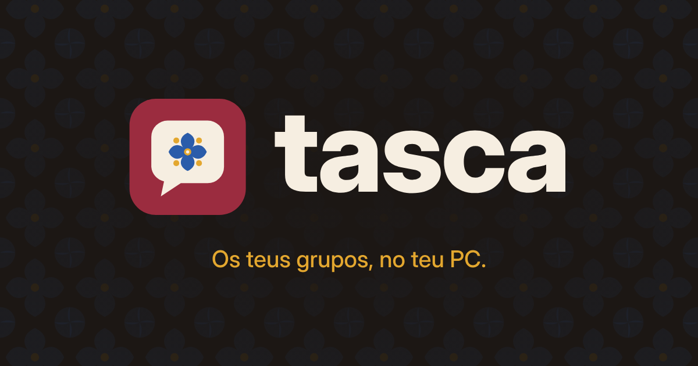

# Tasca

Chat e chamadas de voz **P2P**, feito em Rust. Os grupos vivem nos PCs dos utilizadores, sem servidores centrais.

## Como funciona

- **Cada grupo vive no PC do dono** (o anfitrião), numa base de dados SQLite local.
- **Os membros ligam-se diretamente ao anfitrião** através do [iroh](https://github.com/n0-computer/iroh). Quando não dá para ligar diretamente por causa do router, o tráfego passa por um relay, sempre encriptado de ponta a ponta.
- **A identidade é um par de chaves ed25519.** A mesma chave autentica a ligação QUIC, por isso ninguém consegue fingir ser outra pessoa.
- **Tudo o que acontece num grupo é um evento assinado** pelo autor: criar o grupo, entrar, enviar uma mensagem. Qualquer membro consegue verificar o histórico.
- **Cada membro guarda uma cópia do histórico.** Se o PC do dono desaparecer, o grupo pode ser recuperado.
- **Entra-se num grupo com um código de convite** (`tasca1...`) que o anfitrião gera.

## Estrutura

| Pasta | O que é |
|---|---|
| `crates/tasca-core` | Núcleo: identidade, eventos assinados, SQLite, rede P2P |
| `crates/tasca-cli` | Programa de teste em linha de comandos |
| `assets/brand` | Logos, ícones e paleta de cores |

## Experimentar (linha de comandos)

Precisas do [Rust](https://rustup.rs). No PC do anfitrião:

```
cargo run -p tasca-cli -- criar "Malta" --nome Tiago
```

Aparece um convite `tasca1...`. Noutro PC (ou noutra janela, com outra pasta de dados):

```
cargo run -p tasca-cli -- --dados ./outro entrar tasca1... --nome Ze
```

Para voltar a abrir um grupo teu: `cargo run -p tasca-cli -- hospedar`.

Opções úteis:
- `--local` usa só a rede local, sem relays.
- `--relay https://...` usa o teu próprio relay.

Os dados ficam em `%APPDATA%\Tasca` no Windows.

## Testes

```
cargo test
```

## Plano

1. ✅ Núcleo de rede: grupos, convites, texto e histórico
2. Aplicação desktop (Tauri) para Windows
3. Chamadas de voz
4. Loja de plugins com aprovação da equipa

## Licença

MIT ou Apache-2.0, à tua escolha.
